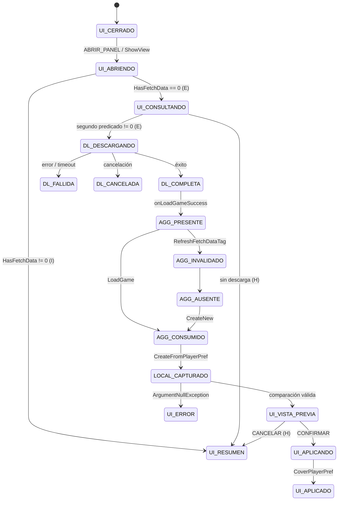

# Máquina de estados de la recuperación en la nube

**La apertura del panel no demuestra por sí sola una descarga.** La evidencia
estática de 8.8.0 muestra una ruta condicional `ShowView → UseOldLogic →
FetchData(false)` y una caché en memoria (`HasFetchData` / `LoadedGameData`)
que la vista previa puede reutilizar. La sesión autenticada de 5.4 no se pudo
repetir; por tanto, este documento separa lo confirmado en el binario de lo
observado en la sesión histórica y de lo que sigue siendo hipótesis.

## Método y etiquetas

| Etiqueta | Significado |
| --- | --- |
| **E** | Evidencia estática reproducible en el APK 8.8.0 (ELF, IL2CPP, direcciones virtuales). |
| **O** | Observación de una sesión oficial: UI, log o medición de red conservada. |
| **I** | Inferencia a partir de E u O; no se ejecutó la transición. |
| **H** | Hipótesis pendiente; requiere una medición discriminante. |

Fuentes principales: [comparación FetchData](../phase5-3/fetch-comparison.md),
[cronología 5.3](../phase5-3/session-timeline.md),
[error de vista previa](../phase5-3/preview-error.md) y
[contratos RPC](../phase5-trace/rpc.md). Las direcciones son virtuales del ELF
AArch64 o ARM antes de la reubicación.

## 1. Estado de interfaz

| Estado | Definición | Evidencia |
| --- | --- | --- |
| `UI_CERRADO` | El panel de nube no está montado. | E/O |
| `UI_ABRIENDO` | Se invoca `CloudSaveDataView.ShowView`. | E |
| `UI_RESUMEN` | El panel muestra el resumen remoto y el control de recuperación. | O (5.1) |
| `UI_CONSULTANDO` | La vista espera una consulta o una descarga iniciada por el panel. | E (ruta condicional) |
| `UI_VISTA_PREVIA` | `LoadGame` construyó una comparación y se muestra el diálogo de reemplazo. | O (5.1, segundo intento) |
| `UI_ERROR` | La vista previa falla antes del diálogo o la consulta devuelve error. | O (5.1, `ArgumentNullException`) |
| `UI_APLICANDO` | Se confirmó y el runner aplica el agregado. | O (5.1, `CloudSaveRunner` / `CoverPlayerPref`) |
| `UI_APLICADO` | El panel local refleja el progreso restaurado. | O (5.1) |

El estado de interfaz no determina por sí solo si hubo una transferencia. Un
resumen visible puede proceder de una consulta previa, de una caché o de una
respuesta parcial.

## 2. Estado de autenticación

| Estado | Definición | Evidencia |
| --- | --- | --- |
| `AUTH_SIN_SESION` | No hay sesión de cuenta aceptada. | O (formulario vacío en 5.3) |
| `AUTH_AUTENTICANDO` | El formulario oficial envió credenciales y espera resultado. | O (5.1) |
| `AUTH_AUTENTICADO` | `OnLoginResultAction` y el menú confirman la sesión. | O (5.1) |
| `AUTH_EXPIRADA` | La sesión en caché ya no es aceptada por el servicio. | H; el SDK contempla `Renew` y `HasSession` |
| `AUTH_RECHAZADA` | Credenciales, cuenta o canal no admitidos. | H; `LoginErrorCode` incluye causas tipadas |

La sesión autenticada de 5.1 es histórica. No se conservó el AVD ni un token
utilizable, y 5.3 solo alcanzó el formulario vacío. Para 5.4 no hay una sesión
autorizada disponible; esta dimensión queda **BLOQUEADA** en la práctica.

## 3. Estado de descarga

| Estado | Definición | Evidencia |
| --- | --- | --- |
| `DL_INACTIVA` | No hay una descarga en curso. | E |
| `DL_CONSULTANDO` | El agente espera metadatos o una respuesta de descarga. | E |
| `DL_DESCARGANDO` | `FetchData(false)` o `ForceFetchData()` tiene una tarea activa. | E |
| `DL_COMPLETA` | La tarea terminó y entregó un `JsonPayload`/texto. | E |
| `DL_FALLIDA` | Timeout, error HTTP, respuesta nula o error tipado. | E |
| `DL_CANCELADA` | La operación se cancela con su `CancellationToken`. | E; el efecto sobre la caché no se observó |

`FetchData(bool showUI)` crea un origen de cancelación y llama al slot de
`BlobSaveClient` con un `CancellationToken`. `ForceFetchData()` usa
`LoginApi.DnloadSave` y callbacks de éxito/fallo. La evidencia no demuestra qué
transporte eligió la cuenta de prueba.

## 4. Estado del agregado en memoria

| Estado | Definición | Evidencia |
| --- | --- | --- |
| `AGG_AUSENTE` | `LoadedGameData` es nulo y `HasFetchData` vale 0. | E |
| `AGG_PRESENTE` | `onLoadGameSuccess` guardó el agregado en +0x70 y puso el indicador a 1. | E |
| `AGG_INVALIDADO` | `RefreshFetchDataTag` limpia el indicador y `SetLoadedDataToNull` escribe nulo. | E; se desconoce el llamador concreto |
| `AGG_CONSUMIDO` | `LoadGame` leyó el agregado para construir la comparación. | E |
| `AGG_APLICADO` | `CoverPlayerPref` persistió el agregado y los subsistemas. | E/O |

La caché es un campo estático del agente. No se observó su política de
vigencia, ni si una restauración confirmada la invalida, ni si cerrar el panel
la limpia.

## 5. Estado de restauración local

| Estado | Definición | Evidencia |
| --- | --- | --- |
| `LOCAL_INTACTO` | No se tocó el progreso local. | O |
| `LOCAL_CAPTURADO` | `CreateFromPlayerPref` construyó el resumen local. | O (5.1) |
| `LOCAL_COMPARADO` | Se calcularon diferencias con `CloudSaveExtraData`. | E |
| `LOCAL_PENDIENTE` | El diálogo espera confirmación o cancelación. | O (5.1, segundo intento) |
| `LOCAL_APLICANDO` | El runner escribe preferencias y subsistemas. | E/O |
| `LOCAL_APLICADO` | El progreso local coincide con el agregado aplicado. | O (5.1) |
| `LOCAL_FALLIDO` | La vista previa o la aplicación falla. | O (5.1, primer intento) |

## Eventos

| Evento | Quién lo produce | Efecto observado o inferido |
| --- | --- | --- |
| `ABRIR_PANEL` | Titular | `ShowView`; lee `HasFetchData`. |
| `SHOWVIEW_CON_CACHE` | `ShowView` | Si `HasFetchData != 0`, el resumen puede reutilizar `LoadedGameData` (**I**). |
| `SHOWVIEW_SIN_CACHE` | `ShowView` | Si `HasFetchData == 0`, `UseOldLogic` evalúa un segundo predicado y puede llamar `FetchData(false)` (**E**). |
| `FETCH_OK` | Agente | `onLoadGameSuccess` guarda el agregado, marca el indicador y permite el resumen. |
| `FETCH_FAIL` | Agente | Rama de error/timeout; el panel muestra un estado de fallo (**H** para la UI exacta). |
| `FETCH_CANCEL` | Panel o cancelación | Se cancela la tarea; el agregado previo puede seguir presente (**H**). |
| `RECUPERAR` | Titular | `LoadGame` lee `LoadedGameData` o crea un resumen nuevo. |
| `CANCELAR_DIALOGO` | Titular | Se cierra la vista previa sin aplicar; no se observó si invalida la caché (**H**). |
| `CONFIRMAR` | Titular | El runner aplica el agregado; no se observó una segunda descarga (**H**). |
| `CERRAR_PANEL` | Titular | No se observó si `RefreshFetchDataTag` se ejecuta al cerrar (**H**). |
| `REABRIR_PANEL` | Titular | Si el indicador sigue a 1, no debería repetirse `FetchData`; si se invalidó, sí (**H**). |
| `SESION_EXPIRA` | SDK/servicio | `FetchData` puede fallar con 401 y exigir renovación (**H**). |
| `SIN_PARTIDA_REMOTA` | Servicio | Puede devolver un agregado vacío, un error tipado o una marca nula; la UI exacta no se observó (**H**). |

## Transiciones con evidencia estática

| Desde | Evento | Hasta | Evidencia |
| --- | --- | --- | --- |
| `UI_CERRADO` | `ABRIR_PANEL` | `UI_ABRIENDO` / `UI_RESUMEN` | `ShowView` y la vista del panel. |
| `UI_ABRIENDO` | `HasFetchData == 0` | `UI_CONSULTANDO` | Rama `UseOldLogic`. |
| `UI_CONSULTANDO` | segundo predicado != 0 | `DL_DESCARGANDO` | Llamada a `FetchData(false)` en ARM. |
| `DL_DESCARGANDO` | éxito | `DL_COMPLETA` + `AGG_PRESENTE` | `onLoadGameSuccess` escribe +0x70 y el indicador. |
| `AGG_PRESENTE` | `RECUPERAR` | `AGG_CONSUMIDO` + `LOCAL_CAPTURADO` | `LoadGame` lee +0x70 y `CreateFromPlayerPref`. |
| `AGG_AUSENTE` | `RECUPERAR` | `LOCAL_CAPTURADO` | `LoadGame` usa `CloudSaveGameData.CreateNew`. |
| `LOCAL_CAPTURADO` | comparación | `UI_VISTA_PREVIA` o `UI_ERROR` | `CloudSaveExtraData` y `GetExceptRMBPayDescribe`. |
| `UI_VISTA_PREVIA` | `CONFIRMAR` | `UI_APLICANDO` → `UI_APLICADO` | `CloudSaveRunner` / `CoverPlayerPref` (5.1). |
| `AGG_PRESENTE` | `RefreshFetchDataTag` | `AGG_INVALIDADO` | Limpia el indicador y escribe nulo. |

## Transiciones no demostradas

| Pregunta | Hipótesis A | Hipótesis B | Prueba discriminante |
| --- | --- | --- | --- |
| ¿Abrir el panel descarga siempre? | Solo si `HasFetchData == 0` y el segundo predicado se cumple. | `ShowView` siempre consulta metadatos y a veces descarga. | Medir `FetchData` y el tráfico en la misma ventana; comparar primera y segunda apertura. |
| ¿Cancelar invalida la caché? | El agregado sigue en +0x70 y reabrir reutiliza. | Cancelar llama `RefreshFetchDataTag` y fuerza otra descarga. | Cancelar, reabrir y medir si hay nueva descarga antes de recuperar. |
| ¿Confirmar vuelve a descargar? | Aplica el agregado retenido. | El runner o el RPC obtienen otra revisión. | Correlacionar revisión recibida y revisión aplicada; no basta el mismo digest. |
| ¿Cerrar el panel limpia el estado? | El campo estático persiste. | El cierre ejecuta la invalidación. | Comparar `HasFetchData` antes y después de cerrar, con diagnóstico autorizado. |
| ¿Qué ocurre sin partida remota? | El servicio devuelve una marca nula. | Devuelve un agregado vacío o un error tipado. | UI y log de una cuenta sin respaldo; sin inventar el estado. |
| ¿Una sesión expirada reutiliza la caché? | `FetchData` falla y la caché previa sigue visible. | La caché se invalida y se pide login. | Expirar la sesión de forma controlada y observar panel. |

## Diagrama de estados

Las aristas marcadas **H** no se ejecutaron en una sesión autenticada. El
diagrama no afirma que `UI_RESUMEN` implique una transferencia nueva.

## Lo que falta para cerrar la máquina

1. Una sesión oficial del titular, instrumentada por etapas, con reloj
   monotónico y un identificador de ensayo.
2. Marcas separadas para `ABRIR_PANEL`, `FETCH_OK`, `RECUPERAR`, `CANCELAR` y
   `CONFIRMAR`, sin mezclar sesiones.
3. Una comparación entre la revisión recibida y la consumida. El mismo
   SHA-256 puede provenir de descargar dos veces los mismos bytes; no prueba
   por sí solo una segunda transferencia.
4. Un caso de cuenta sin respaldo y un caso de sesión expirada.

El [protocolo de repetición](../phase5-3/session-timeline.md) y el
[sondeo de 5.3](../phase5-3/session-sample.sh) siguen siendo la base. La
[sesión autenticada de 5.4](authenticated-session.md) documenta por qué esta
fase no pudo ejecutarlos.
