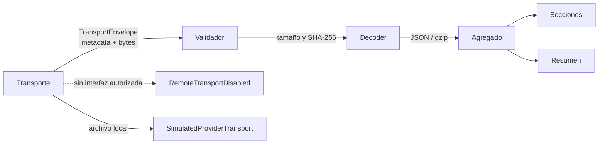

# Prototipo de cliente Linux sin emulador

**El backend ya puede recibir, verificar, decodificar y consultar una copia
de agregado sin Android.** Lo que no puede hacer es obtenerla por sí solo. El
prototipo separa transporte, formato, verificación e importación, mantiene el
transporte remoto deshabilitado y usa un proveedor local simulado para las
pruebas de integración.

## Estructura

La organización existente ya tenía `cloud_save.py` (formato), `cloud_envelope.py`
(clasificación RPC) y `cloud_import.py` (fuente local). Para no duplicarlos, se
añadió un paquete que los compone:

```text
backend/app/
├── cloud/
│   ├── __init__.py       # alcance y límites
│   ├── transport.py      # contrato, transporte deshabilitado y proveedor simulado
│   ├── decoder.py        # detección JSON/gzip y clasificación RPC
│   ├── validator.py      # tamaño, SHA-256 y formato antes de interpretar
│   ├── importer.py       # transporte → validación → decodificación
│   └── preview.py        # estados nulo/ausente para la vista previa
├── cloud_save.py         # reconstrucción del agregado (existente)
├── cloud_envelope.py     # discriminador RPC (existente)
└── cloud_import.py       # fuente local y CLI (existente)
```

`cloud_import.py` ahora reutiliza `verify_copy_bytes` del validador. Su API y
su CLI no cambiaron: `CopyIntegrityError` sigue disponible desde
`app.cloud_import` y las pruebas existentes siguen pasando.

## Flujo



El validador no confía en el transporte: compara el tamaño y el SHA-256
anunciados con los bytes recibidos antes de parsear. El decodificador solo
acepta JSON UTF-8 o un gzip completo; un sobre RPC comprimido o una marca nula
producen un error tipado, no una interpretación especulativa.

## Uso

```python
from pathlib import Path

from app.cloud.importer import CloudImporter, import_from_transport
from app.cloud.transport import DisabledRemoteTransport, SimulatedProviderTransport

# Copia local ya suministrada por el titular.
transport = SimulatedProviderTransport(Path("copia.json"), revision="local-1")
result = import_from_transport(transport)
print(result.summary())
print(result.section("itemData"))

# Límite explícito y transporte inyectable.
importer = CloudImporter(transport, limit=1_048_576)
revision = importer.fetch()

# El transporte remoto no se puede usar.
try:
    import_from_transport(DisabledRemoteTransport())
except Exception as exc:  # RemoteTransportDisabled
    print(exc.code)  # transport_disabled
```

La CLI existente sigue funcionando para una copia local:

```bash
cd backend
uv run --locked python -m app.cloud_import ../ruta/copia.json --section itemData
```

No se añadió una ruta HTTP. El editor individual conserva sus endpoints; el
prototipo es una capa de procesamiento para una copia que ya llegó al backend.

## Transporte

| Implementación | Red | Uso | Comportamiento |
| --- | --- | --- | --- |
| `DisabledRemoteTransport` | No | Estado actual | Lanza `RemoteTransportDisabled` (`transport_disabled`). |
| `SimulatedProviderTransport` | No | Integración y pruebas | Lee un archivo regular, calcula tamaño/SHA-256 y entrega `TransportEnvelope`. |
| `CloudTransport` (Protocol) | Depende | Conector futuro | Debe devolver una revisión completa y respetar el límite. |

`SimulatedProviderTransport` acepta `declared` para simular una revisión
anunciada con tamaño o hash incorrectos. La verificación falla en el validador,
no en el transporte.

## Errores tipados

| Código | Origen | Significado |
| --- | --- | --- |
| `transport_disabled` | `transport.py` | No hay interfaz remota autorizada. |
| `transport_unavailable` | `transport.py` | Archivo ausente, no regular o ilegible. |
| `size_limit` | `cloud_save.py` | Entrada vacía o mayor que el límite. |
| `integrity_mismatch` | `validator.py` | Tamaño o SHA-256 distintos de la revisión. |
| `unknown_format` | `cloud_save.py` | No es JSON UTF-8 ni gzip. |
| `rpc_null_marker` | `decoder.py` | Marca nula del sobre RPC. |
| `rpc_codec_unknown` | `decoder.py` | Bloque RPC comprimido sin códec demostrado. |
| `invalid_aggregate` | `cloud_save.py` | JSON válido pero agregado incompatible. |
| `absent_section` | `cloud_import.py` | La sección solicitada no existe. |

Los errores no incluyen el contenido de la copia. Los resúmenes omiten
identificadores, hash y valores de progreso.

## Pruebas

| Verificación | Resultado |
| --- | --- |
| Suite pública | 169 aprobadas, 9 omitidas. |
| Suite con las nueve muestras privadas de 8.6.0 | 178 aprobadas. |
| Pruebas nuevas del prototipo | 15 aprobadas (`tests/test_cloud_transport.py`). |
| Cobertura de las nuevas pruebas | Transporte deshabilitado y simulado, JSON/gzip, hash/tamaño, límites, archivo ausente/FIFO, RPC comprimido/nulo, truncado, formato desconocido, fixture 8.8.0 sintético y ausencia de sockets. |
| Frontend | `npm run build` correcto; 4 pruebas Playwright aprobadas. |

Las pruebas no requieren APK, Android, cuenta ni red. La muestra sintética
8.8.0 está en `tests/fixtures/cloud-save-880-sintetico.json`; no es una copia
real.

## Lo que demuestra y lo que no

**Demuestra** que una copia recibida por cualquier medio puede validarse e
interpretarse en Linux, con límites, errores tipados y secciones. También
demuestra que el flujo se puede integrar con un transporte inyectable sin
tocar el núcleo.

**No demuestra** autenticación, consulta remota, descarga, descompresión RPC,
restauración en el juego ni compatibilidad con un agregado real de 8.8.0. El
transporte remoto permanece cerrado hasta que exista una interfaz documentada
y autorizada.

## Conector futuro

Un conector autorizado solo necesita implementar `fetch_latest(limit)`. El
resto del flujo no cambia. Antes de habilitarlo se debe verificar:

1. Consentimiento del titular y ámbito de solo lectura.
2. `RevisionMetadata` con etiqueta, tamaño y SHA-256 de los bytes exactos.
3. Límite de 8 MiB y errores tipados.
4. Muestra autorizada para validar el códec y el esquema.
5. Ausencia de secretos en logs y en el repositorio.

[Mapa de dependencias](transport-dependency-map.md) ·
[Consumo de recursos](resource-benchmark.md) ·
[Especificación RPC](rpc-format-specification.md)
