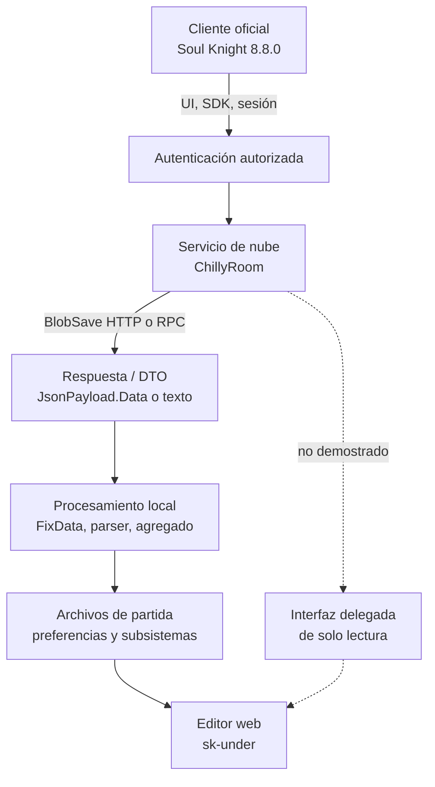

# Análisis del transporte y de las capas RPC

**El cliente 8.8.0 contiene dos caminos de descarga y ninguno está demostrado
para la cuenta de prueba.** `FetchData` usa `BlobSaveClient.DownloadAsync` y
recibe un `JsonPayload`; `ForceFetchData` usa `LoginApi.DnloadSave` y recibe
texto por callback. La respuesta se convierte en `CloudSaveGameData` y se
guarda en `LoadedGameData`. El backend solo puede reproducir hoy la parte
local: clasificar el sobre, validar una copia ya entregada y reconstruir el
agregado. No se llamó a ningún endpoint privado.

## Componentes

| Componente | Capa | Entrada | Salida | Transformación | Evidencia y límite |
| --- | --- | --- | --- | --- | --- |
| `LoginApi.DnloadSave` | RPC de aplicación | Sesión, identidad y parámetros del agente | Texto por `Action<string>`; error por `Action<Err,Exception>` | `CallRpc` y `LoginApi._Decompress` | Firma y llamada desde `ForceFetchData`; falta la respuesta real y el cuerpo del RPC. |
| `BlobSaveClient.DownloadAsync` | HTTP/DTO | `CancellationToken` | `Task<JsonPayload>` | `HttpClient.SendAsync`, estado HTTP y cabeceras | Slots 4/5 y `JsonPayload.Data`; falta el cuerpo y las cabeceras de una respuesta. |
| `JsonPayload.Data` | DTO externo | Respuesta HTTP | String administrado | Deserialización del DTO | El nombre administrado no fija la clave JSON de red. |
| `FetchData(bool showUI)` | Agente | `bool`, cancelación | `Task<JsonPayload>`; el agente devuelve `(bool, ErrorResponse)` | Crea cancelación, llama BlobSave, parsea `Data` | Ruta base y llamada virtual confirmadas; transporte elegido por la cuenta, no. |
| `ForceFetchData()` | Agente | Sesión | `(bool, Err)` | Callbacks de `DnloadSave`; éxito/fallo | Máquina asíncrona y RPC; no se identificó un evento de UI que la elija. |
| `CloudSaveGameData` | Agregado | Texto parseado | Modelo con versión, identidad, `gameData` y subsistemas | `FixData` + parser + serializador/canal | Modelo confirmado; representación JSON exacta pendiente. |
| `LoadedGameData` | Caché en memoria | Agregado de éxito | Campo estático +0x70 | `onLoadGameSuccess` guarda; `RefreshFetchDataTag` invalida | Campo y accesores confirmados; política de vigencia desconocida. |
| `cloud_envelope.py` | Límite local | Bytes ya suministrados | `RpcFrame` con `kind`, `original` y `body` | Discriminador de 4 bytes | Solo clasificación; no descomprime el cuerpo RPC. |

## Secuencia solicitada

| Arista | Estado | Evidencia |
| --- | --- | --- |
| Cliente → autenticación | **Confirmado** en 5.1 | Login oficial, menú y panel. |
| Autenticación → servicio | **Confirmado** por la UI | Resumen remoto y restauración; sin contrato delegado. |
| Servicio → respuesta | **Parcial** | Forma del DTO y del callback; faltan bytes y cabeceras. |
| Respuesta → procesamiento | **Confirmado estáticamente** | `result.Data` → `ParseJsonToCloudSaveGameData` → `FixData`. |
| Procesamiento → archivos | **Confirmado estáticamente y observado** | `CoverPlayerPref`; restauración de 5.1. |
| Archivos → editor | **No implementado** | No hay exportación del agregado al backend. |
| Servicio → interfaz delegada | **Hipotético** | No se localizó una API pública; no se probó. |

## Dónde aparece cada transformación

| Transformación | Dónde | Confirmado | Pendiente |
| --- | --- | --- | --- |
| Compresión HTTP | `BlobSaveClient` negocia `Accept-Encoding`; el tipo declara `ContentIsGzipEncoded`. | Cabeceras y predicado en el cliente. | Si la respuesta del respaldo vino comprimida. |
| Compresión RPC | `LoginApi._Decompress` lee un entero de 4 bytes; `0x80000000` llama `ZipHelper.Decompress(body, 4, len-4)`. | Discriminador y offset en AArch64 y ARM. | Algoritmo interior y salida de `ZipHelper.Decompress`. |
| Deserialización del DTO | `BlobSaveClient` lee un `JsonPayload`; `Data` es un string. | Tipo y campo. | Clave JSON de red, codificación y límites. |
| `FixData` | Parser del agente y del runner. | Llamada y texto vacío. | Migraciones y ramas por canal. |
| Parseo del agregado | `ParseJsonToCloudSaveGameData(string)`. | Llamada y retorno. | Esquema efectivo por versión. |
| Serialización local | `CloudSaveGameData.CoverPlayerPref`. | Escritura de subsistemas. | Bytes locales 8.8.0 comparables. |

## Dependencia de la versión

| Elemento | Dependiente de versión | Evidencia |
| --- | --- | --- |
| `serialzedVersion` | Sí | Campo entero del agregado; constructor base escribe 1. |
| Secciones del agregado | Sí | Modelos por subsistema; pueden aparecer, faltar o ser nulos. |
| `FixData` y serializadores | Sí | Ramas por canal y opción de serializador. |
| `UseBlobCloudSave` / IFix | Sí | Selección por canal y reemplazos en ejecución. |
| Marcador RPC | Probable | El binario lo implementa; no se demostró que cambie por versión. |
| Códec local de archivos | Sí | Nueve familias de 8.6.0; 8.8.0 no tiene muestra. |

## Operaciones locales y operaciones del proveedor

| Operación | Local | Proveedor | Evidencia |
| --- | --- | --- | --- |
| Clasificar el sobre RPC | Sí | No | `inspect_rpc_frame`. |
| Verificar tamaño y SHA-256 | Sí | No | `verify_copy_bytes`. |
| Descomprimir gzip de un agregado suministrado | Sí | No | `reconstruct_cloud_save`. |
| Reconstruir el agregado | Sí, con contrato provisional | No | `cloud_save.py`. |
| Extraer secciones | Sí | No | `cloud_import.py`. |
| Autenticar la cuenta | No | Sí | SDK oficial. |
| Consultar metadatos remotos | No | Sí | `GetSaveTimeInfo`/panel. |
| Descargar la revisión | No | Sí | BlobSave o RPC. |
| Restaurar en el juego | No | Cliente oficial | `CoverPlayerPref`. |

## Conclusión

La frontera demostrada es **procesar una copia ya recibida**. La frontera no
demostrada es **adquirirla**. `cloud_envelope.py` no es un cliente RPC: solo
reconoce los marcadores que el APK usa para decidir si hay un bloque
comprimido, una marca nula o un array que se conserva. Convertirlo en un
cliente remoto exigiría una muestra autorizada del cuerpo, el códec interior y
un contrato de acceso; ninguna de las tres cosas está disponible.

[Especificación del formato](rpc-format-specification.md) ·
[Mapa de dependencias](transport-dependency-map.md) ·
[Contratos RPC de 5.2](../phase5-trace/rpc.md) ·
[BlobSave](../phase5-trace/blobsave.md)
