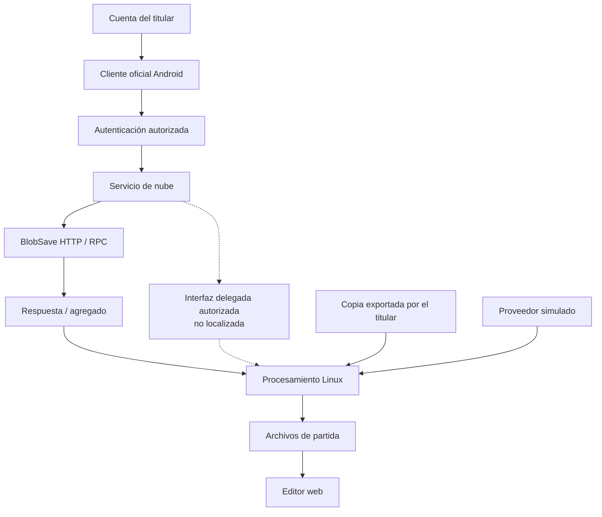

# Mapa de dependencias del transporte

**Una operación solo es independiente de Android si sus entradas ya están en
Linux.** La autenticación, la consulta y la descarga siguen dependiendo del
cliente oficial o de una interfaz autorizada que no existe. La verificación,
la descompresión, la reconstrucción, la extracción de secciones y la edición
local ya funcionan sin Android.

## Matriz por operación

| Operación | Cliente oficial | Linux actual | Interfaz autorizada | Bloqueo o evidencia |
| --- | --- | --- | --- | --- |
| Iniciar sesión en la cuenta | Sí | No | No demostrada | Acción interactiva del titular; sin SDK delegado. |
| Consultar metadatos remotos | Sí | No | No demostrada | `GetSaveTimeInfo`/panel; falta contrato. |
| Descargar la revisión | Sí | No | No demostrada | BlobSave/RPC; faltan bytes y autorización. |
| Recibir una copia suministrada | No | Sí | — | `LocalFileSource`, `SimulatedProviderTransport`. |
| Verificar tamaño y SHA-256 | No | Sí | — | `verify_copy_bytes`. |
| Detectar JSON/gzip | No | Sí | — | `detect_format`. |
| Clasificar un sobre RPC | No | Sí | — | `inspect_rpc_frame`; solo clasificación. |
| Descomprimir un agregado gzip | No | Sí | — | gzip de un miembro, con CRC y fin de stream. |
| Reconstruir el agregado | No | Sí, contrato provisional | — | `reconstruct_cloud_save`. |
| Extraer secciones | No | Sí | — | `ImportedCopy.section`. |
| Validar la vista previa | No | Parcial | — | `preview_issues`; solo estados nulo/ausente. |
| Reconstruir archivos locales 8.6.0 | No | Sí | — | 9/9 verificados. |
| Editar y exportar una copia intacta | No | Sí | — | Motor y adaptador de solo lectura. |
| Restaurar en el juego | Sí | No | No demostrada | `CoverPlayerPref`; escritura local del cliente. |
| Exportar el agregado al backend | No | No | No demostrada | No hay salida oficial localizada. |

## Dependencias por capa

Las aristas punteadas no están implementadas ni autorizadas. La copia
exportada y el proveedor simulado son las dos entradas que sí existen.

## Frontera de autorización

| Regla | Aplicación en el repositorio |
| --- | --- |
| No eludir autenticación | No hay formulario, token, cookie ni automatización de login. |
| No eludir controles del servicio | No se llaman endpoints privados ni se reimplementan firmas. |
| No publicar secretos | `.env` y `*.data` están ignorados; las pruebas privadas leen variables de entorno. |
| Transporte remoto deshabilitado | `DisabledRemoteTransport` lanza `RemoteTransportDisabled`. |
| Proveedor simulado local | `SimulatedProviderTransport` lee un archivo regular y no abre sockets. |
| Consentimiento explícito | Un conector futuro debe documentar al titular, el ámbito y la operación. |

## Contrato mínimo de un conector futuro

Si el proveedor publica una interfaz autorizada, el conector debe:

1. Identificar al titular y el ámbito de solo lectura con un consentimiento
   verificable.
2. Entregar `RevisionMetadata` (etiqueta opaca, tamaño y SHA-256) junto con los
   bytes exactos.
3. No registrar tokens, credenciales ni contenido de la partida.
4. Respetar el límite de 8 MiB y fallar con un error tipado.
5. Ser sustituible por `SimulatedProviderTransport` en las pruebas.
6. Aportar una muestra autorizada que permita verificar el códec y el esquema
   antes de habilitar producción.

Hasta entonces, el backend solo procesa copias que el titular ya tiene. Esa es
la dependencia reducida que 5.4 puede demostrar. [Consumo de recursos](resource-benchmark.md) ·
[Prototipo Linux](linux-client-prototype.md) ·
[Sesión autenticada](authenticated-session.md)
