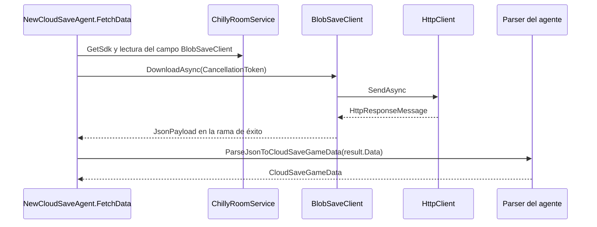

# Cómo llega BlobSave al parser

**En el ELF AArch64 de 8.8.0, el camino base de `NewCloudSaveAgent.FetchData` descarga un `JsonPayload` a través del cliente BlobSave.** El enlace faltaba en la Fase 5 porque el compilador emitió una llamada virtual. Se verificó con el layout de campos, los slots de métodos y los tipos genéricos de las máquinas asíncronas.

| Punto de comprobación | Evidencia en el APK de referencia |
| --- | --- |
| Selección de cliente | En `<FetchData>d__84.MoveNext` (VA `0x07f1d940`), la llamada a `GetSdk` en +0x218 precede a la lectura de +0x50 del objeto devuelto. El layout de `Generated.ChillyRoomSdkClient.ChillyRoomService` asigna +0x50 a `BlobSaveClient` y +0x58 a `RPCClient`. |
| Llamada | En `0x07f1db7c` se carga la pareja función/método de la tabla virtual y en `0x07f1db84` se invoca con el argumento de cancelación. Las dos sobrecargas de descarga ocupan los slots 4 y 5. El slot 5 recibe `CancellationToken`. Ambas devuelven `Task<JsonPayload>`. |
| Resultado HTTP | `<DownloadAsync>d__16` conserva `HttpResponseMessage`, cabeceras multivalor y estado entero. Sus esperas incluyen `ObjectResponseResult<JsonPayload>`, `ObjectResponseResult<ErrorResponse>` y texto. El código compara con 200, 400, 401 y 500. Falta observar la respuesta concreta del respaldo y su cabecera de contenido. |
| Capa de aplicación | `<FetchData>d__84` contiene `TaskAwaiter<JsonPayload>`. La clausura guarda `result: JsonPayload` y `data: CloudSaveGameData`. En `0x07efca58` lee el resultado y su campo +0x10, que en `JsonPayload` corresponde al texto de `Data`. En `0x07efca6c` llama al parser y conserva el agregado devuelto. |
| Errores | El agente programa cancelación y tiene ramas para resultado nulo/timeout y fallo. Su tarea devuelve un par booleano y `ErrorResponse`. El contrato de retorno permite distinguirlo del `Err` de `ForceFetchData`. |
| Subida, solo inspección estática | `UploadAsync(JsonPayload[, CancellationToken]) → Task<bool>`. La máquina serializa el DTO con Json.NET, llama a `Compress` y construye `ByteArrayContent`. El helper obtiene UTF-8, crea dos `MemoryStream` y copia entre streams. La descarga consulta `Accept-Encoding` y existe un predicado sobre cabeceras para gzip. La compresión efectiva de la respuesta sigue abierta. |

El método base `UseBlobCloudSave` (VA `0x064451c8`) comprueba IFix. En la rama sin reemplazo ejecuta `mov w0,#1` en +0x30 y retorna. La variante Huawei consulta una propiedad por reflexión y comprueba cadenas. La llamada identificada al selector pertenece a una migración. Queda por determinar qué entrada elige el agente en cada canal y qué reemplazos estaban activos durante la restauración de 32 bits.

## Reproducción de la lectura estática

Usar el APK identificado en el [informe de Fase 4](../phase4/apk.md), las definiciones de tipos y métodos IL2CPP y la biblioteca en `lib/arm64-v8a`. Resolver punteros relativos con las relocaciones ELF. La tabla de 152 692 punteros a tipos comienza en VA `0x0f93ac08` y la tabla por definición de offsets de campos en `0x0fd15c30` (46 649 entradas). Por ejemplo, el índice de retorno 49649 de `0x0601f1b7` conduce a una instancia genérica de Task cuyo argumento es el tipo `0x02003b1d`. El getter de ese tipo retorna string. Comparar las instrucciones de la clausura y la máquina del agente permite comprobar independientemente cómo se consume el resultado. Las direcciones son virtuales de esta biblioteca, anteriores a la reubicación en ejecución.

El diagrama representa dependencias en el binario base. La [cronología](timeline.md) identifica por separado los eventos que registró Android.

## Contraste con el ABI que ejecutó el AVD

Se repitió la resolución en `lib/armeabi-v7a/libil2cpp.so` del mismo APK. El módulo Assembly-CSharp tiene 213 048 entradas y su array de métodos empieza en VA `0x0e722c7c`. La tabla por tipo de offsets de campos está en `0x0e6bc400`. En 32 bits, BlobSaveClient está en +0x28 del servicio, RPCClient en +0x2c y Data en +0x08 del DTO. La máquina de FetchData llama a GetSdk en `0x0587d39c`, lee +0x28 en `0x0587d3b0` y despacha la llamada virtual en `0x0587d3f0`. Esta segunda lectura confirma que el receptor de la llamada es también BlobSaveClient en el ABI instalado. Las direcciones describen el binario del paquete; un parche dinámico o la elección de otra entrada requieren verificación en la sesión.
