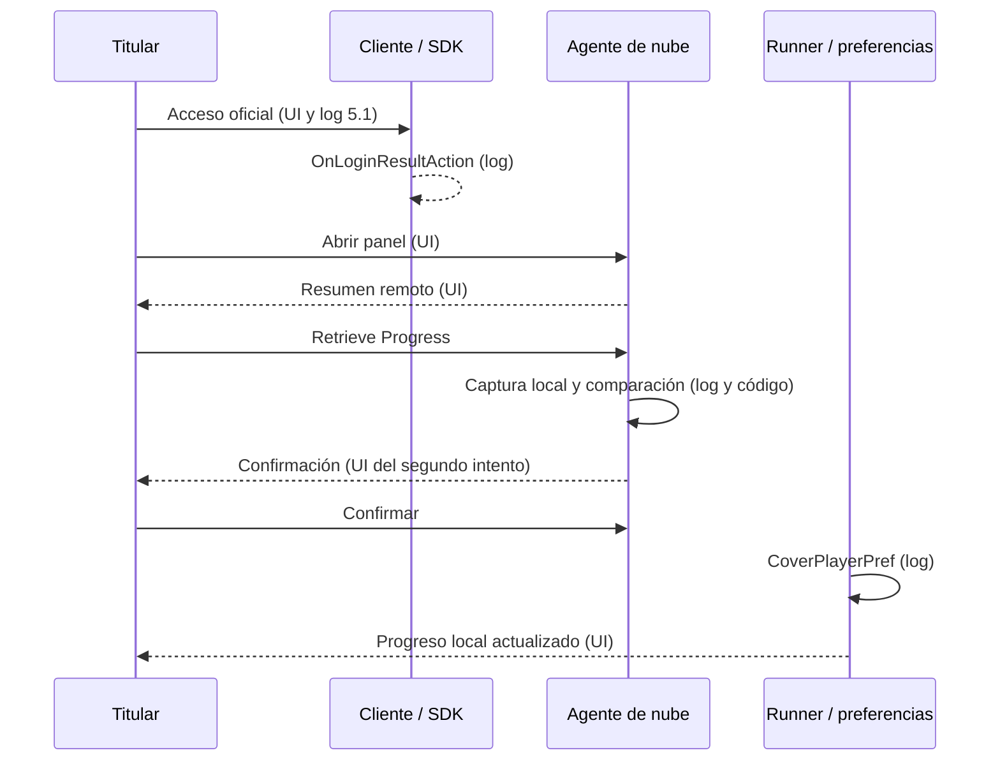

# Cronología del cliente y de la red

## Medición nueva · 2026-11-23 UTC

APK original SHA-256 `54bb332be9444596501ec99f745f21adfa55265feea3a15331c735009b517f34`. AVD Google Play API 30 nuevo, tipo user, SELinux Enforcing, paquete 8.8.0, ABI instalado armeabi-v7a. Se usó epoch de logcat y del invitado para evitar el desfase de presentación de hora de la Fase 5.1. Las acciones desde el host tienen resolución de un segundo. Las horas de captura de pantalla son cotas de observación, no el instante de transición.

| Hora UTC | Etapa | Evidencia | Relación con la red |
| --- | --- | --- | --- |
| 04:00:37 y 04:00:42 | Control previo | Dos muestras antes de abrir la actividad | Cero TCP establecidos al 443 del UID en ambas. |
| 04:00:45 | Primer arranque | Lanzamiento de BasePlayerActivity | A las 04:00:48, un socket del juego. |
| 04:00:51.469 | Carga de IL2CPP | Log `JNI_OnLoad` | A las 04:00:53, siete sockets a tres destinos. |
| 04:01:13.873 | Inicialización del SDK | Marco `InitSDK` | A las 04:01:14, siete sockets. A las 04:01:19, once a ocho destinos. |
| 04:01:20.625 | Estado de recursos | Marco `InitSuccessAndChannelConfirmedAndResourcesPrepared`; después se vio descarga al 79 % | El RX de wlan0 creció durante la ventana. Los bytes incluyen servicios del sistema. |
| 04:02:41.691 | Fallo del primer proceso | Android crash, SIGSEGV | Cuatro sockets en la muestra de 04:02:42 y cero en 04:02:47. |
| 04:03:18 | Segundo lanzamiento, misma instalación | Actividad oficial; `JNI_OnLoad` a 04:03:26.011 e `InitSDK` a 04:03:43.127 | De cero a cinco sockets entre 04:03:18 y 04:03:23. |
| 04:05:32.583 y 04:05:33.670 | Arranque previo al login | ClientHello con SNI del proveedor y destino coincidente con sockets del UID | `api-gateway.soulknight.chillyroom.com` y `dc.chillyroom.com` respectivamente. |
| A más tardar 04:05:55 | Selección de método | UI con la opción ChillyRoom Account | Ya existían conexiones antes de abrir el formulario. |
| 04:06:05 a 04:06:30 | Apertura del formulario | Toque a 04:06:05, marcador `LoginOptions` a 04:06:09.215 y formulario vacío visible a más tardar a 04:06:30 | Cuatro sockets del UID en las muestras de 04:06:04 y 04:06:25. No se envió el formulario. |

## Flujo autenticado · evidencia histórica de 5.1

| Hora documentada | Acción o evento | Tipo de evidencia |
| --- | --- | --- |
| 03:11:06 UTC | Envío del formulario; después `EmailOrPhoneLogin`, `OnLoginResultAction` y menú | Acción del operador, log e interfaz. |
| 03:13:41 UTC | Panel de nube con respaldo existente | Interfaz con resumen y control para recuperar. |
| 03:14:44 UTC | Primer intento | Pulsación; reloj del invitado 04:14:48.366 captura local y 04:14:48.817 excepción en la vista previa. |
| 03:23:01 UTC | Segundo intento tras el tutorial | Diálogo de reemplazo local. |
| 03:23:53 y desde 03:24:07 UTC | Confirmación y aplicación | Acción del operador, marcos `CloudSaveRunner` y `CoverPlayerPref`, coincidencia visual posterior. |

La ventana histórica registró `FetchData` y `NewCloudSaveAgent`. El informe conservado carece del frame calificado, la hora de esa llamada y el identificador de operación. Una precarga del agregado al abrir el panel es compatible con la evidencia. Se desconoce si confirmar volvió a transferir el documento. [Experimento 5.1](../phase5-experimental/experimentos.md)

Las aristas internas de FetchData y ForceFetchData se describen en los informes de transporte. Su posición temporal exacta no quedó registrada en la sesión autenticada.
