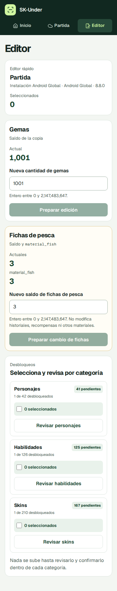
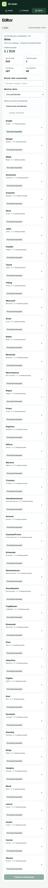

# Fase 6.19 — Skins confirmadas, investigación de fichas y tarjeta de resurrección, editor móvil

**Estado:** el desbloqueo de skins queda **confirmado por el propietario** para el
alcance probado (E3, `confirmed_by_owner`). **No se declara E4**: falta repetir la
prueba de persistencia después de guardar de nuevo desde el cliente oficial. El
progreso acumulado de compras de fichas de pesca y la tarjeta de resurrección
superior **no se implementan** porque no se identificó un campo de guardado
escribible con semántica confirmada. El editor móvil se reorganizó en una vista
rápida y vistas por categoría.

## 1. Resultado por objetivo

| Objetivo | Resultado | Cambio funcional |
| --- | --- | --- |
| Consolidar skins | Etiqueta experimental retirada; política interna `confirmed_by_owner`; evidencia E3 | Ninguno en `gameData.skinLock`; se conserva la escritura de `Value=1` en posiciones existentes |
| Recompensas por compras acumuladas de fichas | Candidatos documentados; sin campo de guardado identificado | Ninguno; el editor de fichas no cambia |
| Tarjeta de resurrección superior | Candidatos documentados; semántica no resuelta | Ninguno; no se añadió control |
| Editor móvil | Vista rápida, rutas por categoría, selección compartida y texto reducido | Cambios de interfaz; mismos endpoints de preparación, confirmación y restauración |

No se modificaron niveles, mascotas, materiales, semillas, planos, precios,
recibos, monedas nuevas ni recompensas. No se automatizó la reclamación de
ningún premio.

## 2. Confirmación de skins

En un dispositivo Android físico, con el cliente oficial y la versión 8.8.0, el
propietario confirmó que:

- las skins editadas desde SK-Under se subieron y recuperaron desde la nube;
- todas las skins seleccionadas aparecieron desbloqueadas y disponibles dentro
  del juego;
- las skins no seleccionadas, los personajes, las habilidades y la selección
  registrada conservaron su estado.

La implementación funcional **no cambió**: solo se actualizaron la etiqueta, la
política, la evidencia y la documentación. El editor sigue sin crear posiciones,
sin agregar personajes y sin tocar `gameData.currentSkinDatas`. La evidencia es
E3; no se declara E4 porque no se repitió la comprobación después de guardar de
nuevo desde el cliente oficial.

| Campo | Política | Nivel | Alcance |
| --- | --- | --- | --- |
| `gameData.skinLock` | `confirmed_by_owner` | E3 | Posiciones existentes; `Value=1`; confirmación en Android físico; sin prueba de persistencia posterior |
| `gameData.currentSkinDatas` | solo lectura | E2 | Se conserva sin cambios; no se usa como prueba de posesión |

## 3. Recompensas por compras acumuladas de fichas

### 3.1 Semántica confirmada y observada

- `gameData.fishChip` (`Int32`) y `itemData.materials.material_fish` (`Int32`)
  son el saldo actual y su material espejo. Están confirmados en E4 para el
  alcance de saldo, compra y guardado descrito en la fase 6.16. **No** son un
  contador de compras acumuladas.
- `itemData.cumulativeFishCount` (`Int32`) es un contador histórico de peces
  capturados (`7218` en la muestra 8.6.0; `0` en 8.8.0). No es el saldo ni el
  progreso de la tienda.
  **Corrección de la Fase 6.20:** el desensamblado 8.8.0 demuestra que
  `FishChipPurchaseController` y la barra de recompensas leen este campo; es el
  progreso acumulado de la tienda, no un contador de peces capturados.
- `mallReloadData.buyFishCount5/10/20/45/68/128` son seis `Int32`. Se
  interpretan como contadores de paquetes o compras de peces, pero **todas las
  muestras observadas están a 0**. No hay una muestra legítima con un valor
  positivo que permita confirmar su semántica ni su proyección.
- `itemData.fishChipStorePurchaseHistory`,
  `fishChipStorePurchaseHistoryIndexed`,
  `fishChipStoreAllPurchaseHistoryIndexed` y
  `lastFishChipStoreAllPurchaseHistoryIndexed` son objetos o mapas de historial.
  En 8.8.0 están vacíos; en 8.6.0 se observaron dos claves con valor 0. No se
  usan para calcular recompensas.
- `itemData.fishChipConfigId` es una cadena de configuración de tienda.
- `statisticData.StatisticsData.HallGameStatisticData._buyItemUseFishChipTimes`
  es un mapa escena → entero de uso histórico (`{"Any": 999}` en 8.6.0). No es
  progreso de recompensas.
- PlayerPrefs `<perfil>_furniture_fish_chips` (`int`) apareció tras una
  recuperación con valor 0. No se interpreta como compras acumuladas.

### 3.2 Evidencia del cliente 8.8.0

La inspección estática de `global-metadata.dat` encontró símbolos que prueban
que el juego distingue un contador de compras acumuladas del saldo:

- `CumulativePurchaseFishChip` y `cumulativePurchaseFishChip`;
- `MallFishChipRewardManager`, `FishChipReward`, `FishChipRewardStatistics`,
  `FishChipRewardUpdate`, `OnFishChipRewardUpdate`,
  `RefreshFishChipRewardRedPoint`, `TbFishChipReward`,
  `store_tbfishchipreward`, `DeserializeFishChipReward`,
  `UIMallFishChipRewardWidget`;
- `DonateRewardController`, `HasNextDonateReward`, `FlushDonateRewardUI`,
  `DriedFishAmount`, `FishChipProgress`, `FishChipKing`;
- `FishChipPurchaseController`, `TryBuyWithFishChips`,
  `FishChipStorePanel`, `FishChipStoreOtherConfig`.

Estos símbolos demuestran un sistema de progreso y recompensas, pero **no**
identifican una ruta de guardado. Ningún archivo descifrado contiene un campo
`cumulativePurchaseFishChip` ni un contador distinto de los `buyFishCount*`.
`CumulativePurchaseFishChip` aparece en la lista de miembros de
`CloudSaveSundry`, no en un agregado de guardado observado.

### 3.3 Decisión

No se añadió un contador ni un editor de «Progreso de recompensas». Hacerlo
implicaría inventar una ruta o reutilizar un contador de paquetes sin evidencia,
y podría alterar recompensas o historiales reales. El editor confirmado de
`gameData.fishChip` + `material_fish` permanece sin cambios.

## 4. Tarjeta de resurrección superior

Se investigaron estos candidatos:

| Candidato | Tipo / ubicación | Observación |
| --- | --- | --- |
| `gameData.rebornCard` | booleano JSON | Único campo de guardado relacionado; el registro lo mantiene en solo lectura E2 |
| `<perfil>_reborn_card` | entero en PlayerPrefs | Se reconstruye tras la recuperación; no se conoce si es derecho, cantidad o estado |
| `itemData.RebornCard` | cadena de catálogo | Nombre de objeto; no es una cantidad de tarjetas |
| `RebornCardUnlock`, `RebornCardConfig`, `UpdateRebornCard`, `onBuyRebornCard` | metadatos / configuración | Prueban la existencia del sistema, no una ruta de guardado de la tarjeta superior |
| `ResurrectionCard`, `_ResurrectionCard` | símbolos de interfaz de pausa | Pueden ser resurrecciones en partida, no una tarjeta permanente |

No se encontró un campo específico de «tarjeta superior», una cantidad separada
ni una proyección verificada al cliente oficial. Tampoco se puede distinguir con
seguridad entre tarjeta permanente, consumible, resurrección en partida y estado
temporal. **No se añadió ningún control de activación**; el campo sigue siendo
solo lectura y cualquier cambio queda como investigación pendiente.

## 5. Arquitectura del editor móvil

### 5.1 Vista rápida (`/editor`)

Muestra únicamente:

- saldo de gemas y su editor compacto;
- saldo de fichas de pesca y su editor compacto;
- tres tarjetas de desbloqueo: Personajes, Habilidades y Skins.

Cada tarjeta muestra desbloqueados, pendientes, selección actual, una casilla
para seleccionar o limpiar todos los pendientes compatibles y un enlace
**Revisar**. La casilla solo modifica la selección: **no prepara ni sube nada**.
El editor rápido no monta las listas completas de personajes, habilidades o
skins.

### 5.2 Vistas por categoría

Rutas reales:

- `/editor/personajes`
- `/editor/habilidades`
- `/editor/skins`

Cada ruta monta una sola sección y ofrece un enlace **← Editor**. `App.tsx`
reconoce cualquier ruta bajo `/editor/` como la vista de editor y mantiene
activa la navegación principal. Las tarjetas internas por personaje se abren
cerradas y solo renderizan sus filas al expandirse; las skins ya usaban
renderizado diferido y las habilidades dejaron de abrirse automáticamente.

### 5.3 Estado compartido

`frontend/src/unlockSelections.ts` define las claves y los conjuntos de
selección:

- personajes: código del personaje;
- habilidades: `código:índice`;
- skins: `código:índice`.

El estado vive en `NativeEditor`, no en cada sección. Por eso:

- seleccionar todo en la vista rápida se refleja al entrar en la categoría;
- desmarcar un elemento individual actualiza el recuento de la vista rápida;
- la selección se conserva al volver, cambiar de categoría o navegar a Inicio y
  regresar;
- los elementos ya desbloqueados no se cuentan como pendientes ni se vuelven a
  seleccionar;
- tras una subida verificada, las claves aplicadas se excluyen de los pendientes
  aunque el informe descargado todavía no se haya actualizado.

No hay preparación conjunta de varias categorías. Cada categoría prepara su
propio candidato desde su propia descarga y conserva los campos no
seleccionados; no se encadenan subidas de agregados obsoletos.

### 5.4 Texto y móvil

Se retiraron los avisos largos permanentes de personajes, habilidades y skins,
las explicaciones repetidas y los resúmenes duplicados. Se conservan avisos
breves de escritura deshabilitada, catálogo ausente, personaje bloqueado,
sobrescritura y respaldo. Los paneles de gemas y fichas son más compactos. La
vista rápida usa una columna en pantallas estrechas, controles de al menos
44 px, sin desbordamiento horizontal y sin listas largas montadas.

El informe de solo lectura dejó de mostrarse dentro del editor nativo para
reducir altura y duplicación; sigue disponible en las vistas de laboratorio y
cuentas vinculadas.

### 5.5 Capturas móviles

Las capturas se generaron con Playwright a 390 × 844 sobre un fixture sintético
y saneado, sin datos de cuenta, y se guardan en esta carpeta. La vista anterior
medía 18.073 px de alto porque montaba las listas de personajes, habilidades y
skins en la pantalla principal. La vista rápida nueva
mide 1.955 px. La vista detallada de skins se capturó con las tarjetas cerradas:
solo renderiza las filas al expandir un personaje.

| Antes: editor único | Después: vista rápida |
| --- | --- |
|  |  |

## 6. Seguridad preservada

No se modificaron el respaldo cifrado, la confirmación explícita (`SUBIR`),
la validación estructural, el rechazo de borradores obsoletos, la verificación
por descarga, la restauración (`RESTAURAR`), la conservación de campos no
seleccionados ni la comprobación de catálogo. Las skins siguen exigiendo
posiciones existentes y reproducción inversa byte a byte. No se escriben campos
nuevos ni se inventan recibos, transacciones o derechos de compra.

## 7. Pruebas ejecutadas

- Backend: `572 passed, 16 skipped`.
- Frontend: `npm run build` correcto.
- Playwright: `47 passed`.
- Se actualizaron las pruebas de política de skins a `confirmed_by_owner`, E3 y
  `experimental: false`.
- Se añadieron pruebas de vista rápida, tarjetas de categoría, sincronización de
  selección rápida/detallada, persistencia al navegar, ausencia de listas largas
  en la pantalla principal, rutas por categoría, tarjetas cerradas y ancho móvil.
- Se conservaron las pruebas de respaldo, confirmación, verificación,
  restauración, rechazo de estructuras incompatibles y preservación de campos no
  seleccionados.

La imagen Docker se construyó con `docker build -t soul-knight-editor:phase6-19 backend` y se verificó con `verify_image_catalog.py` bajo `uid=10001`, sin privilegios. El catálogo, las preparaciones individuales, múltiples y masivas de personajes, habilidades y skins, los controles de catálogo ausente/corrupto y las fichas se validaron correctamente. El contenedor arrancó con usuario `10001:10001` y `/api/v1/health` respondió `status: ok`.

## 8. Limitaciones

- Las skins quedan en E3; no hay prueba de persistencia después de un nuevo
  guardado del cliente oficial.
- El progreso acumulado de compras de fichas no tiene campo de guardado
  identificado ni muestra con valor positivo.
- La tarjeta de resurrección superior no tiene un campo específico ni semántica
  confirmada.
- No se implementó preparación conjunta de varias categorías.
- El informe de solo lectura no se muestra en el editor nativo; los recuentos
  principales sí se muestran en las tarjetas.

## 9. Verificación manual en Android para el propietario

1. Abrir SK-Under en el móvil, iniciar sesión y descargar la partida.
2. En **Editor**, comprobar que la vista rápida muestra Gemas, Fichas de pesca y
   las tres tarjetas, sin listas largas.
3. En **Personajes**, **Habilidades** o **Skins**, seleccionar pendientes y usar
   **Preparar desbloqueo**. Revisar el resumen, confirmar y subir.
4. Verificar que la nube conserva la copia modificada.
5. Abrir el cliente oficial, recuperar la partida y comprobar que las skins
   seleccionadas aparecen disponibles y que las no seleccionadas conservan su
   estado.
6. Guardar de nuevo desde el cliente oficial y volver a recuperar. Esta segunda
   comprobación es la que permitiría proponer E4 en una fase futura.
7. Confirmar que no existe un control de recompensas acumuladas ni de tarjeta de
   resurrección superior, y que el editor de fichas sigue modificando únicamente
   el saldo y `material_fish`.